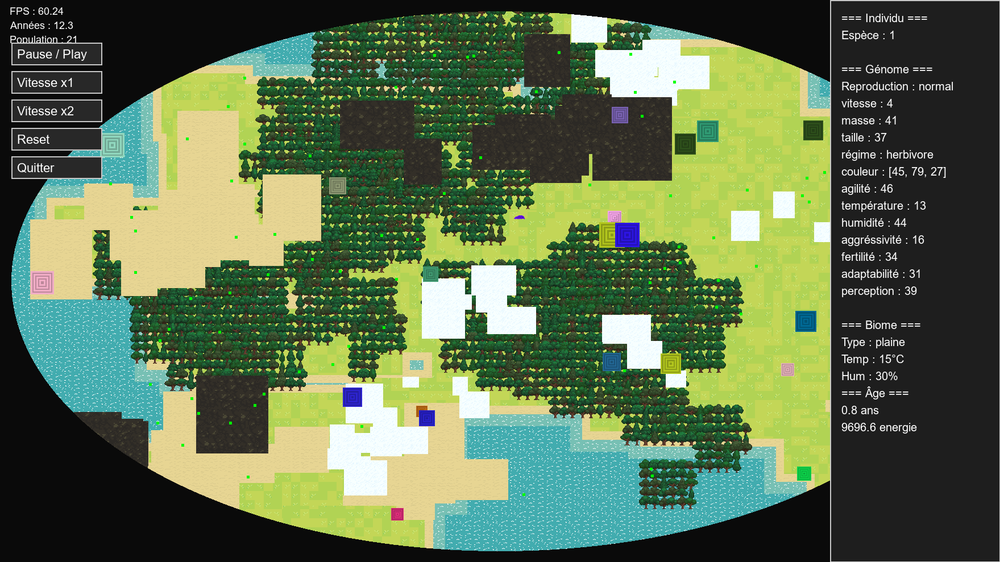
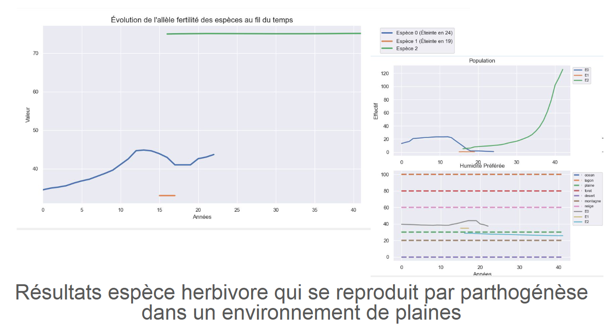

# NeoRiza — Simulateur d'Écosystème Dynamique et d'Évolution Biologique Numérique

**NeoRiza** est un simulateur de vie artificielle en 2D développé en Python. On l'a conçu pour modéliser des mécanismes de la sélection naturelle (hérédité, mutation, spéciation et adaptation) dans un environnement procédural soumis à des contraintes climatiques et trophiques.

L'utilisateur se retrouve observateur actif (*Sandbox / Godhand*); il configure les conditions initiales de l'écosystème, peut interagir en temps réel avec les "populations" et enfin, il peut analyser l'émergence ou l'extinction des lignées avec des outils statistiques et phylogénétiques qui sont nativement intégrés.

> Pour le contexte, il s'agit ici de notre projet de fin de 1re année du **Cursus Master en Ingénierie (CMI) Informatique** à la Faculté des Sciences de l'Université de Montpellier.

---



---

## Fonctionnalités et Architecture Algorithmique

Le moteur repose sur une architecture inspirée de MVC (mais en plus chaotique ...). Le but était de séparé strictement logique biologique/physique du GUI et du module d'analyse de données (14 modules Python, 19 classes, +2 300 lignes de code source pur).

### 1. Génétique et Spéciation Dynamique en `O(n)`
Chaque agent (`Individu`) possède un `Genome` composé d'une liste d'objets `Allele` dictant ses caractéristiques morphologiques et comportementales (vitesse, masse, fertilité, perception, agressivité, préférences thermiques et hydriques), associées à un taux (`mutation_rate`) et un pas de mutation (`mutation_step`).

Pour détecter l'émergence de nouvelles espèces en temps réel sans subir le coût d'une comparaison croisée en $O(n^2)$, le moteur calcule à chaque génération un **archétype dynamique** correspondant à la moyenne allélique de l'espèce active, ramenant la complexité en temps à **$O(n)$** :
* **Distance génétique relative :** Pour chaque allèle $a$ de l'individu et $b$ de l'archétype, l'écart est évalué selon $\frac{\vert{}a - b\vert{}}{\text{moyenne}(a, b)}$.
* **Seuil de rupture :** Si la population compte au moins 5 individus et que la dérive maximale dépasse **15 %**, deux mécanismes biologiques sont évalués :
  * **Cladogenèse (Scission d'espèce) :** Si le sous-groupe mutant (distance $\le 20\text{ \%}$) représente au moins $20,5\text{ \%}$ de l'effectif total tout en divergeant de plus de $25\text{ \%}$ d'au moins $35\text{ \%}$ de la population mère, une nouvelle espèce indépendante est créée.
  * **Anagenèse (Dérive globale) :** Si l'archétype actuel a dérivé de plus de $20\text{ \%}$ par rapport au génome fondateur historique de la lignée, l'espèce entière mute vers une nouvelle identité taxonomique.

### 2. Moteur Physique, Comportement de Groupe (*Boids*) et *QuadTree*
* **Déplacements vectoriels (*Boids*) :** Les trajectoires des entités combinent trois forces vectorielles (Séparation, Alignement, Cohésion) pondérées dynamiquement par les allèles d'agressivité et de perception de chaque individu.
* **Interactions trophiques et survie :** Lors d'une collision inter-espèces, la prédation est résolue selon l'écart d'agressivité et un score de survie intégrant l'âge, l'agilité et l'adéquation métabolique au biome courant.
* **Partitionnement spatial (*QuadTree*) :** Afin d'éviter une dégradation quadratique des performances lors des tests de collision et de voisinage, l'espace 2D (délimité par un masque elliptique `ALLOWED_MASK`) est subdivisé dynamiquement en sous-régions via un arbre quaternaire (`src/core/optimisation.py`).

### 3. Génération Procédurale de l'Environnement
Le module `map_generation.py` construit des mondes organiques selon une approche probabiliste :
* **Ossature continentale :** Placement des masses terrestres par distributions gaussiennes centrées.
* **Transitions côtières :** Génération automatique de halos périphériques (lagons peu profonds et plages de sable)s lorsque le biome de fond est aquatique.
* **Clusters intra-biomes :** Création d'épicentres distants dotés d'un noyau central dense (« anti-trous ») et d'une dispersion gaussienne de sous-rectangles assurant des bordures irrégulières. Chaque biome applique des contraintes locales de température et d'humidité qui régulent le métabolisme et la fertilité des agents, ainsi que la croissance des ressources végétales (`Plante`).

### 4. Persistance des Données et Analyse Scientifique
Sur déclenchement de l'utilisateur, l'état complet de l'écosystème est sérialisé dans `data/evolution_data.json` :
* **Validation et nettoyage statistique :** La variable booléenne `a_existe` vérifie que le pic démographique historique d'une souche est strictement positif avant exportation, éliminant ainsi le bruit statistique lié aux espèces pré-initialisées en mémoire mais jamais instanciées sur la carte.
* **Visualisation :** Génération automatisée de courbes démographiques, de suivi de dérive allélique, d'adéquation climatique (`Matplotlib` / `Seaborn`) et d'arbres phylogénétiques orientés par générations (`NetworkX` via `nx.multipartite_layout`).



---

## Arborescence du Projet
```text
ProjetS2-2026-CMI/
├── assets/                     # Ressources multimédias centralisées
│   ├── maps/                   # Tuiles graphiques classées par biomes
│   ├── sounds/                 # Effets sonores et ambiances (MP3)
│   └── sprites/                # Apparences des entités
├── data/
│   └── evolution_data.json     # Base de données générée en temps réel
├── docs/                       # Documentation complète (Rapport, Cahiers, Manuel)
├── src/
│   ├── core/                   # Outils bas niveau du moteur
│   │   ├── config.py           # Constantes globales (W, H, ALLOWED_MASK)
│   │   ├── optimisation.py     # Partitionnement spatial (QuadTree)
│   │   └── son.py              # Gestionnaire audio
│   ├── simulation/             # Logique métier (Modèle)
│   │   ├── entites/            # Classes physiques (Individu, Livings, Espece)
│   │   ├── environnement/      # Génération procédurale (WorldMap, Biome, Plante)
│   │   └── genetique/          # Patrimoine génétique et mutations (Genome, Allele)
│   ├── tools/                  # Contrôleur d'analyse scientifique
│   │   └── graph.py            # Export JSON, graphes statistiques et phylogénie
│   └── ui/                     # Interface graphique (Vue)
│       ├── info_panel.py       # Volet d'inspection génétique individuelle
│       └── menu.py             # Menus de configuration Sandbox et HUD
├── main.py                     # Point d'entrée de l'application
└── requirements.txt            # Dépendances Python

```

---

## Installation et Démarrage

### Prérequis

* **Python 3.10+** (développé et testé sous Python 3.12)
* Bibliothèques tierces : `pygame`, `matplotlib`, `networkx`, `seaborn`

### Installation

Clonez le dépôt et installez les dépendances depuis la racine du projet :
```bash
git clone [https://github.com/mea-me/ProjetS2-2026-CMI.git](https://github.com/mea-me/ProjetS2-2026-CMI.git)
cd ProjetS2-2026-CMI
pip install -r requirements.txt

```

### Lancement

Exécutez le script principal :
```bash
python3 main.py
```

---

## Contrôles et Utilisation

Après avoir configuré la topologie de la carte (taille `S` à `XL`, complexité `1` à `5`, pondération des biomes) et les souches initiales (1 à 4 espèces, effectifs de 5 à 50, régime herbivore/carnivore/omnivore, reproduction sexuée ou parthogenèse), les commandes suivantes sont disponibles en cours de simulation :

| Commande | Action |
| --- | --- |
| **`Entrée`** | Mettre la simulation en pause ou reprendre l'exécution |
| **`Clic gauche`** *(sur un agent)* | Ouvrir le panneau latéral d'inspection (`InfoPanel` : génome détaillé, énergie, âge, espèce) |
| **`P`** | Activer / désactiver le **Mode Pose** (intervention manuelle *Godhand*) |
| **`Clic droit`** *(en Mode Pose)* | Ouvrir le menu radial d'apparition d'individus aléatoires ou prédéfinis (Requin, Blob, Dragon...) |
| **`1`** | Déclencher une catastrophe locale (explosion létale à la position du curseur) |
| **`G`** | Mettre en pause, sauvegarder la base JSON et ouvrir le **Menu d'Analyse Graphique** |
| **Boutons HUD** | Contrôle de la vitesse (`x1`, `x2`), `Pause/Play`, `Reset` et `Quitter` |

---

## Performances et Perspectives d'Évolution

### Bilan des performances

Les campagnes de test montrent une fluidité constante à **60 FPS jusqu'à environ 200 entités simultanées** (plage optimale pour l'interprétation scientifique des dynamiques de spéciation), et un maintien au-dessus de **30 FPS jusqu'à 400 individus**.

### Axes d'amélioration identifiés

* **Découplage architectural :** Extraire la logique de spéciation actuellement logée dans `main.py` vers un sous-module dédié dans `src/simulation/genetique/`.
* **Synchronisation temporelle des graphes :** Corriger le léger décalage de l'axe des abscisses observé lors d'une utilisation prolongée du mode accéléré (`x2`) en indexant l'export sur l'âge réel de la simulation plutôt que sur le compteur d'itérations.
* **Enrichissement analytique :** Ajouter un graphe de prédation dédié (matrice trophique et causes de mortalité comparées : famine, vieillesse, combat).

---

## Documentation et Auteurs

Certains des livrables imposés durant ce cours (Manuel d'utilisation, Rapport complet, etc) sont consultables dans le dossier [`docs/`](docs/pdf/).

**Équipe de développement :**
* **Mahé BÉNARD**
* **Manon BARRAL**
* **Thomas KELEMEN**
* **Basile LEBRUN**

```